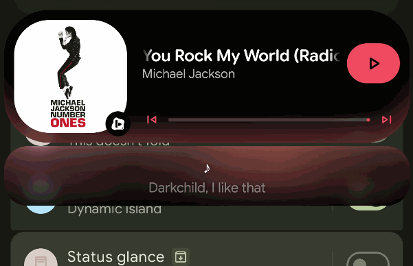

<p align="center">
  
</p>

<h1 align="center">Synced</h1>

<p align="center">Synced lyrics for whatever is playing, shown on the Essentials island.</p>

> [!IMPORTANT]
> **Synced works ONLY with the island SDK of [sameerasw/essentials](https://github.com/sameerasw/essentials).**
> It is a provider for the Essentials island, not a standalone lyrics app. It has no screen of its own,
> and without Essentials installed it does nothing.

## What it does

When you play a song in any music app, Synced:

1. Reads the song's title, artist, album and length from the active media session.
2. Looks up time-synced lyrics on [lrclib.net](https://lrclib.net).
3. Sends a lyrics card to the Essentials island, where it sits **under the island's media player** and
   follows the song line by line.

<p align="center">
  
</p>


### Settings

These appear under Synced in the Essentials island settings:

| Setting | Default | What it does |
|---|---|---|
| Beat pulse | On | Pulses the island's backdrop to the song's beat. The beat is estimated from the lyric timings, so it can drift on some songs. |
| Lyric line animation | On | Slides and fades lines as they change. With accent glow on, it also sweeps the glow across each line. |
| Show previous line | Off | Shows three lines (previous, current, next) instead of two. |
| Accent glow on current line | Off | Glows the current line in a colour taken from the album art. The sweep follows whole lines, not individual words. |

## Setup

1. Install [Essentials](https://github.com/sameerasw/essentials) and turn on its island.
2. Install Synced and open it once. It asks for notification access, which Android requires for reading
   what's playing. Synced has no other screen.
3. Play a song and expand the island's media player.

If access is missing, the card under the media player reads "Please tap to enable the permissions needed to render lyrics". Tap it to grant access.

## Requirements

- Android 11 (API 30) or newer
- [Essentials](https://github.com/sameerasw/essentials) with island support
- An internet connection, to fetch lyrics from lrclib.net

## Building

```
./gradlew :app:assembleDebug
```

The island SDK modules (`island-sdk`, `island-sdk-compose`) are vendored from Essentials.

## Credits

- Lyrics: [lrclib.net](https://lrclib.net)
- Island SDK: [sameerasw/essentials](https://github.com/sameerasw/essentials)
- Font: Google Sans Flex, under the SIL Open Font License (`app/src/main/assets/licenses/google_sans_flex_OFL.txt`)
